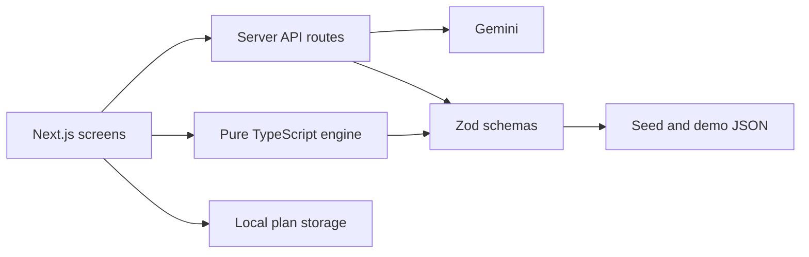

# Utsav (उत्सव) — AI Event Co-Planner

> A calm, transparent AI co-planner for weddings, birthdays, and community celebrations across India.

**Live app:** [Add the deployed Vercel URL](https://your-utsav-deployment.vercel.app) ·
**Product video:** [Demo](https://example.com/utsav-demo) ·
**Walkthrough:** [Video](https://example.com/utsav-walkthrough)


---

## 🌟 Overview

Planning Indian celebrations involves complex multi-day ceremonies (Haldi, Mehendi, Sangeet, Muhurat), vast guest lists, intricate vendor logistics, and budget allocations. 

**Utsav** pairs AI conversational intelligence with **deterministic calculation engines** to give planners, couples, and families a reliable, transparent co-pilot.

### Core Pillars
1. **Deterministic Calculations (`src/lib/engine/`)**: Budget allocations, what-if sliders, due dates, and readiness scores are computed in pure code and covered by focused Vitest tests. The LLM never calculates totals.
2. **Validated AI Pipeline**: Gemini is called from server-side routes and generation scripts. Structured outputs are validated with Zod; the seed generator retries an invalid section once. Secrets are never exposed to the client.
3. **Marigold Noir Design System**: Celebrating Indian festive culture (Fraunces serif headings, Marigold and Noir palette) grounded in accessible, modern web design.
4. **Honest Disclaimers**: All prices are labeled as estimates, all service partners are demo vendors, and cultural rituals note that *"traditions vary by family"*.

---

## 🛠️ Tech Stack

- **Framework**: Next.js 16 (App Router, React 19, Strict TypeScript)
- **Styling**: Tailwind CSS, shadcn/ui design patterns, Lucide icons
- **Typography**: Fraunces (Headings) & Inter (UI) via `next/font`
- **Animation & Motion**: Framer Motion, Lenis Smooth Scroll (respects `prefers-reduced-motion`)
- **Data & Charts**: Recharts, Canvas Confetti
- **Validation & AI**: Zod, `@google/genai` (server-side only)
- **Testing**: Vitest
- **Deployment**: Vercel

---

## 🚀 Getting Started

### Prerequisites
- Node.js 20+
- npm 10+

### Installation
```bash
# Clone the repository
git clone https://github.com/your-username/utsav.git
cd utsav

# Install dependencies
npm install

# Create the local environment file (PowerShell)
Copy-Item .env.example .env.local
```

### Configure AI providers locally

1. Sign in to [Google AI Studio](https://aistudio.google.com/) with your Google
   account, open the [API keys page](https://aistudio.google.com/app/apikey),
   and create an API key for a Google Cloud project.
2. For text backup, create an API key in the [GroqCloud Console](https://console.groq.com/keys)
   and set it as `GROQ_API_KEY`. For image backup, create an API key in
   [OpenRouter](https://openrouter.ai/settings/keys) and set it as
   `OPENROUTER_API_KEY`. These backup providers are optional.
3. Add provider keys to `.env.local` and keep them private: do not paste them
   into frontend code, screenshots, chat, or a `NEXT_PUBLIC_` variable.
   `.env.local` is ignored by Git. Keep the example model values unless you
   have selected other models enabled for your accounts:

   ```env
   GEMINI_API_KEY=your_real_key_here
   GEMINI_MODEL=gemini-3.5-flash-lite
   GEMINI_IMAGE_MODEL=gemini-3.1-flash-image
   GROQ_API_KEY=your_groq_api_key_here
   GROQ_MODEL=openai/gpt-oss-20b
   OPENROUTER_API_KEY=your_openrouter_key_here
   OPENROUTER_IMAGE_MODEL=bytedance-seed/seedream-4.5
   ```

4. Restart the dev server after changing environment variables:

   ```bash
   npm run dev
   ```

   The app calls AI providers only from server-side API routes. Structured text
   generation tries Gemini first and falls back to Groq if Gemini is
   unavailable, over quota, or returns invalid output. Moodboard images try
   Gemini first and then OpenRouter. If neither configured provider succeeds,
   the app uses its clearly marked local fallback. Provider access, quotas, and
   charges depend on your accounts and selected models; OpenRouter image
   generation may incur per-image costs.

#### Check whether Gemini is working

- Submit a custom plan request (demo buttons intentionally load cached plans and
  do not call Gemini).
- If generation is not working, stop the dev server with `Ctrl+C`, confirm
  `.env.local` contains a non-placeholder key for Gemini and/or its relevant
  backup provider, and run `npm run dev` again. Next.js reads local environment
  variables when the server starts.
- If a provider rejects its key, verify the matching server variable and
  provider-console permissions. For Gemini, confirm the key allows Gemini/
  Generative Language API requests; for Groq, confirm the key and model are
  enabled in GroqCloud.
- For quota, model, timeout, or response-validation messages, check the
  terminal running `npm run dev` for the server-side error. Confirm
  `GEMINI_MODEL` is available to your key, then try again. The app deliberately
  shows an offline plan rather than a blank screen when generation fails.

Never paste the key into the browser console, an issue, or a chat message.

### Languages and AI-generated content

Use the language selector in the top navigation to translate the current page
and subsequent pages into Hindi or Sanskrit. The choice is saved in this
browser. Translation sends visible page text to the configured primary or
backup text provider; the original English content is restored when English
is selected. Cached and offline plans can generate an event-specific ceremony
programme from the Ceremonies page. Moodboard images use the configured image
provider fallback chain and show a clear message plus curated visuals if both
providers are unavailable.

### Development
```bash
npm run dev
```
Open [http://localhost:3000](http://localhost:3000) in your browser.

---

## 🧪 Testing & Validation

```bash
# Run unit tests (Vitest)
npm run test

# Type check (strict TypeScript)
npm run typecheck

# Lint check
npm run lint

# Production build
npm run build
```

## 🌱 Seed Data Generation

Seed generation is optional for running the app; the app has committed demo
plans and offline fallbacks. To generate or refresh the illustrative seed JSON,
set `GEMINI_API_KEY` in `.env.local`, then run:

```bash
npm run generate:seed
```

The server-side script uses `GEMINI_MODEL` when set (defaults to `gemini-3.5-flash-lite`), validates every response with Zod and price sanity checks, then writes benchmark estimates, ceremony rituals, event templates, and fictional demo vendors to `data/seed/`. Re-running it replaces those generated files. Prices are illustrative estimates, and vendor names are explicitly fictional.

Generate and score demo-plan runs (the count applies to each of the three
scenarios), then promote a manually selected run after validation:

```bash
npm run generate:demo -- --count 3
npm run generate:demo -- --copy data/demo/_runs/jaipur-wedding/run-01.json --name jaipur-wedding
```

Without a Gemini key, generate deterministic offline fallback plans for local
demo use with `npm run generate:demo:offline`. The app also serves a validated
fallback plan directly when committed demo JSON is not present.

## Features

- Transparent, deterministic budget allocation and guest-count what-if planning.
- Interactive dashboard with next actions, readiness, assumptions, and share-link creation.
- Dependency-aware timeline reflow and a budget what-if screen backed by pure engine functions.
- Read-only plan sharing with compressed, Zod-validated plan data.
- A separate Saved Plans library with detailed dashboard navigation and complete PDF export/import for device-to-device transfers. Imported PDFs are format- and schema-validated; this is not cryptographic proof of origin.
- Gemini-backed plan generation and Zod-validated fictional demo plan loading.
- Marigold Noir landing story with responsive scenes and reduced-motion support.

The Vendors, Ideas, Mood Board, Ceremonies, and Panic screens are still starter
placeholders; seed data and demo-generation foundations are present, but those
end-user workflows are not complete yet.

### Portable plan PDFs

The Saved Plans page can export each complete plan as a readable PDF, preview it
in the app, and download it. The PDF also carries a compressed structured plan
payload for import on another device. A visible SHA-256 transfer-check line is
compared with the embedded payload during import, and the plan is validated with
the shared Zod schema. This consistency check is not a cryptographic signature
and does not prove who created or modified a PDF.

## Architecture



See [docs/ARCHITECTURE.md](docs/ARCHITECTURE.md), [docs/PROMPTS.md](docs/PROMPTS.md),
and [docs/DECISIONS.md](docs/DECISIONS.md) for implementation details.

## Data and estimates

Seed and demo prices are directional estimates, not quotes or a promise of
market pricing. Always verify local rates, taxes, inclusions, and availability
with providers. All generated vendor identities are fictional demo vendors;
they are not real businesses or recommendations. Cultural guidance is general
and commonly practised; traditions vary by family.

## Quality pipeline

1. Generate structured content with Gemini at a restrained temperature.
2. Parse every response with Zod and reject invalid or implausible values.
3. Regenerate a failed seed section once, including validation feedback.
4. Critique and refine demo plans, then validate the final blueprint.
5. Run deterministic calculations in the pure engine and verify with Vitest.

## Environment variables

| Variable | Required | Purpose |
|---|---:|---|
| `GEMINI_API_KEY` | For AI flows | Server-side Gemini API key |
| `GEMINI_MODEL` | No | Text model; defaults to `gemini-3.5-flash-lite` |
| `GEMINI_IMAGE_MODEL` | No | Image model for mood boards |

Never prefix secrets with `NEXT_PUBLIC_`.

## Vercel deployment

1. Push this repository to GitHub. From the project folder:

   ```bash
   git add .
   git commit -m "feat: prepare Utsav for deployment"
   git push
   ```

   Check the staged changes before committing and never stage `.env.local`.
2. Sign in at [Vercel](https://vercel.com/), choose **Add New → Project**, and
   import the GitHub repository. Leave the framework preset as **Next.js**.
   The defaults should detect `npm install` and `npm run build`; no database or
   custom output directory is needed.
3. In **Project Settings → Environment Variables**, add:

   | Name | Value |
   |---|---|
   | `GEMINI_API_KEY` | Your Google AI Studio API key |
   | `GEMINI_MODEL` | `gemini-3.5-flash-lite` |
   | `GEMINI_IMAGE_MODEL` | `gemini-3.1-flash-image` |

   Select **Preview** and **Production** (and **Development** if desired).
   These are server-only variables; never name the key `NEXT_PUBLIC_GEMINI_API_KEY`.
4. Click **Deploy**. Check the deployment build log, then open its Preview URL
   and verify a demo plan, a custom plan, and the fallback behavior. Gemini image
   generation may also depend on model availability for your Google project.
5. To release it, connect a domain in **Project Settings → Domains**, verify the
   Production deployment, and merge/push changes to the configured production
   branch (usually `main`). Vercel builds and deploys that branch automatically.
6. If you add or rotate environment variables later, save them and trigger a
   fresh deployment; existing deployments do not receive updated values.

The demo plan JSON and curated fallback artwork are part of the repository, so
the basic demo works without running seed generation during Vercel's build.
Never commit `.env.local` or put the Gemini key in client-side code.

## Roadmap

- Seating optimizer
- WhatsApp integration
- Contract analyzer
- Venue visualizer
- Real vendor feeds
- Vector search
- Multi-user editing
- Voice and regional languages

---

## ⚖️ License
This project is licensed under the [MIT License](LICENSE).
