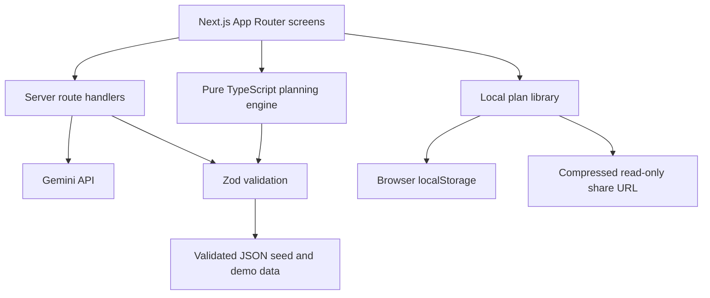

# Architecture

Utsav uses deterministic TypeScript for budgets, timeline dates, readiness, and
sharing. Gemini is reserved for language and creative assistance; all generated
plans and seed data are validated with Zod before they are stored or rendered.

## Plan storage and sharing

`src/lib/storage/plan-library.ts` stores a validated collection under
`utsav-plans` and the selected plan ID under `utsav-active-plan-id`. The legacy
`utsav-plan` key remains the active-plan compatibility mirror for existing
screens and is migrated into the collection on first read. New generated plans
become separate library entries; edits update only the selected entry. The
dashboard can switch between locally saved plans and copy a share link for any
entry.

Share links encode the validated blueprint in the URL with `lz-string`. The
shared route decodes and validates it, then renders a read-only snapshot; there
is no server-side account, synchronization, or shared editing. Anyone with the
URL can view its plan data, so only share links with intended recipients.

## Plan blueprint

The canonical type is `Blueprint` in `src/lib/schemas/blueprint.ts`. It holds
the event context, 10–14 budget categories with integer amounts and percentage
shares, 20–30 dependency-aware timeline tasks, 8–12 vendor categories, at least
three creative themes, menu and invitation ideas, and explicit assumptions.
Budget category `kind` is `per_head`, `fixed`, or `semi`. Percentage shares must
sum to 100; timeline dependencies must reference existing tasks and be acyclic.

## Trust boundaries

Gemini keys are server-side environment variables only. AI results are
untrusted input and must pass their corresponding Zod schemas and numeric sanity
checks. All planning rates and vendor profiles are illustrative estimates;
vendor records are fictional demo data, not real businesses or recommendations.

## Pure engine

`src/lib/engine/` contains deterministic calculations. UI components call these
functions rather than reproducing budget or schedule math. The Vitest suite
covers allocation, scenario changes, schedule dependencies, readiness,
currency formatting, and share-code validation.
